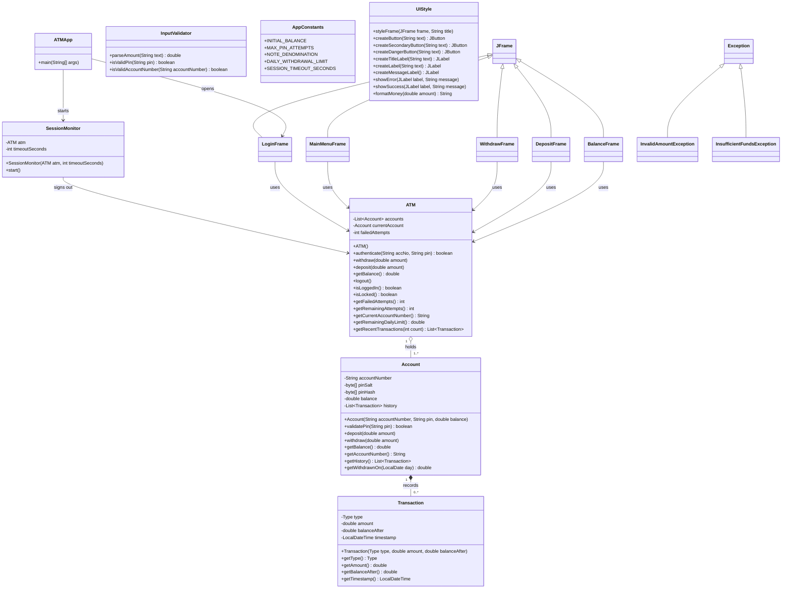

# ATM Application: Group 2

**Course:** Software Design 1 (SDN150S), Cape Peninsula University of Technology
**Project:** No. 2, Java ATM Application
**Due date:** 8 November 2026
**Examiner:** Mr S.O. Ekwe

This README is the team guide. Read it before writing any code. It explains what we are building, who owns which file, the names everyone must use, and how we work in Git.

---

## 1. What we are building

A Java desktop ATM with a Swing (`JFrame`) interface. The user logs in, then chooses from four options:

| Option | What it does |
|---|---|
| Withdraw | Asks for an amount, deducts it from the balance, shows a success message |
| Deposit | Asks for an amount, adds it to the balance, shows a success message |
| Check Balance | Shows the current balance and the five most recent transactions |
| Exit | Closes the program with `System.exit(0)` |

The starting balance is **R10 000.00**.

### What we are marked on

| Part | Weight | Notes |
|---|---|---|
| Code implementation | 40% | Pseudocode (15), UML (15), code (50), demo video (15), scaled to 40% |
| Technical report | 40% | Max 2000 words, Cabri 11, 1.5 line spacing, Harvard referencing, PDF |
| Group participation | 20% | Tools: understand, use, create, evaluate their limits |

### Must-have Java concepts (marks are attached to each)

- **Constructors and modifiers:** every class has a constructor; fields are `private`, methods `public`
- **Control statements:** `if / else`, loops, `switch`, `try / catch`
- **JFrame forms:** hand-coded Swing screens
- **Comments and white space:** single-line and multi-line comments, neat spacing
- **Error handling and input validation**

### Submission checklist

- [ ] Source code (this repo)
- [ ] Technical report as PDF (includes the UML diagram and the pseudocode)
- [ ] Video demonstration, 3 to 5 minutes

---

## 2. How the program is built

The program has three layers. Each person owns separate files, so nobody edits the same file.

```
 Screens (JFrames)   ->   ATM (logic)   ->   Account (data)
 what the user sees       the rules          the balance and PIN
```

- **Account** holds the data: account number, PIN (stored only as a salted PBKDF2 hash), balance and transaction history.
- **ATM** is the controller. It checks logins, blocks the card after 3 wrong PINs, applies the cash rules (whole R10 notes, R5 000 daily limit) and runs the transactions.
- **Frames** only draw the screen and call `ATM`. They contain no banking rules.
- **Helpers** (`InputValidator`, `AppConstants`, `Transaction`, `UIStyle`, two exceptions) are shared by everyone.
- **SessionMonitor** signs the customer out after 120 seconds without mouse or keyboard activity.
- **UIStyle** gives every screen the same window size, font, colours and ready-made buttons and labels, so all five screens look like one app.

All screens receive the **same `ATM` object** through their constructor, so they all see the same balance.

### UML class diagram


The full diagrams (backend, screens, withdraw activity) are in `docs/uml/` and in the report.

### Screen flow

```
Login --(success)--> Main Menu --+--> Withdraw --+
                                 +--> Deposit  --+--> back to Main Menu
                                 +--> Balance  --+
                                 +--> Exit --> System.exit(0)
```

---

## 3. Who owns what

**Rule: you only edit your own files.** If you need a change in someone else's file, ask the owner.

| # | Name | GitHub | Role | Files you own | Your job |
|---|---|---|---|---|---|
| 1 | Aubrey Magolego | [`sinovuyo-asathi-danca`](https://github.com/sinovuyo-asathi-danca) | Data model | `Account.java`, `AppConstants.java` | Constructor, getters, `deposit`, `withdraw`, `validatePin`, constants |
| 2 | Mabandla Nkosi | [`mabandlascelaphile-lgtm`](https://github.com/mabandlascelaphile-lgtm) | Controller | `ATM.java` | Login check, 3-attempt lockout, wraps the Account operations |
| 3 | Vhukhudo Ravele | [`vhukhudo98`](https://github.com/vhukhudo98) | Validation | `InputValidator.java`, `InvalidAmountException.java`, `InsufficientFundsException.java` | Turn text into a valid amount, reject letters, zero and negatives |
| 4 | Muvhofhololi Tsanwani | [`muvhofhololitsanwani-design`](https://github.com/muvhofhololitsanwani-design) | Login screen | `LoginFrame.java` | Account number and PIN fields, error messages |
| 5 | Athenkosi Khau | [`Athenkosi28`](https://github.com/Athenkosi28) | Menu screen | `MainMenuFrame.java` | Four buttons; Exit calls `System.exit(0)` |
| 6 | Kgonyane Makgoale | [`kgonyaneChris`](https://github.com/kgonyaneChris) | Withdraw screen | `WithdrawFrame.java` | Amount field, success and error messages |
| 7 | Ndzalama Mthombeni | [`Precept-cyber`](https://github.com/Precept-cyber) | Deposit screen | `DepositFrame.java` | Amount field, success and error messages |
| 8 | Siyolise Mhlauli | [`mhlaulisiyolise5`](https://github.com/mhlaulisiyolise5) | Integration lead | `ATMApp.java`, `BalanceFrame.java`, `README.md` | `main()`, balance screen, merging pull requests, final testing, demo video |

**Files added during integration:** `Transaction.java` (Aubrey, data model), `SessionMonitor.java` (Siyolise, integration lead) and `test/atm/BackendTests.java` (Kgonyane and Ndzalama, testing). Each file has its owner's name in its header comment.

**Backend and frontend:** members 1 to 3 write backend classes (no Swing). Members 4 to 8 each build their own screen: the Swing layout and the button logic together. There is no single "frontend person".

**Shared look:** `UIStyle.java` is owned by the team leader (Muvhofhololi), on top of their own screen (`LoginFrame`). Everyone else only *calls* it and never edits it. If you want a different colour or font, ask the leader.

**How roles were assigned:** member 4 is the team leader. Roles 1, 2, 3, 5, 6, 7 and 8 were drawn at random. If two people agree to swap, tell the leader and update this table in a pull request so the README always matches who owns what.

### Report sections (everyone writes one part)

| Report part | Owner |
|---|---|
| Introduction and sub-questions | 4 (Muvhofhololi) |
| Design approach and engineering method | 2 (Mabandla) |
| Pseudocode (section 7 below) | 3 (Vhukhudo) |
| UML diagram | 1 (Aubrey) |
| Tools and skills | 5 (Athenkosi) |
| Results and analysis (testing) | 6 (Kgonyane) and 7 (Ndzalama) |
| Conclusion and Harvard references | 8 (Siyolise) |

---

## 4. The shared contract (use these exact names)

Everyone codes against these signatures. Do not rename anything without telling the whole group, because other people's code depends on it.

```java
// Account.java
public Account(String accountNumber, String pin, double balance)   // the PIN is kept only as a salted hash
public boolean validatePin(String pin)
public void deposit(double amount)
public void withdraw(double amount) throws InsufficientFundsException
public double getBalance()
public String getAccountNumber()
public List<Transaction> getHistory()                // added
public double getWithdrawnOn(LocalDate day)          // added

// ATM.java
public ATM()                                         // creates the demo account with AppConstants.INITIAL_BALANCE
public boolean authenticate(String accNo, String pin)
public void withdraw(double amount) throws InsufficientFundsException, InvalidAmountException   // CHANGED: adds InvalidAmountException
public void deposit(double amount)
public double getBalance()
public void logout()
public boolean isLoggedIn()                          // added
public boolean isLocked()                            // added
public int getFailedAttempts()                       // added
public int getRemainingAttempts()                    // added
public String getCurrentAccountNumber()              // added
public double getRemainingDailyLimit()               // added
public List<Transaction> getRecentTransactions(int count)   // added

// InputValidator.java
public static double parseAmount(String text) throws InvalidAmountException
public static boolean isValidPin(String pin)
public static boolean isValidAccountNumber(String accountNumber)   // added

// AppConstants.java
public static final double INITIAL_BALANCE = 10000.00;
public static final int MAX_PIN_ATTEMPTS = 3;
// added: PIN_LENGTH, DEMO_ACCOUNT_NUMBER, DEMO_PIN, NOTE_DENOMINATION,
//        DAILY_WITHDRAWAL_LIMIT, MINI_STATEMENT_SIZE, SESSION_TIMEOUT_SECONDS, getQuickAmounts()

// UIStyle.java (all static, owned by the team leader). The original eight methods are unchanged:
public static void styleFrame(JFrame frame, String title)
public static JButton createButton(String text)
public static JLabel createTitleLabel(String text)
public static JLabel createLabel(String text)
public static JLabel createMessageLabel()
public static void showError(JLabel label, String message)
public static void showSuccess(JLabel label, String message)
public static String formatMoney(double amount)
// added: createSecondaryButton, createDangerButton, createHintLabel, createTextField, createPasswordField,
//        createCheckBox, createQuickAmountPanel, createPanel, createScreenPanel, createCardPanel,
//        createColumn, createHeader, clearMessage
```

Every screen is created with the shared ATM object:

```java
new WithdrawFrame(atm);
```

### Naming rules

- **Everything:** `camelCase` for variables and methods, `PascalCase` for classes
- **Swing components use these prefixes:**

| Component | Name |
|---|---|
| Buttons | `btnWithdraw`, `btnDeposit`, `btnBalance`, `btnExit`, `btnLogin`, `btnConfirm`, `btnBack` |
| Account number field | `txtAccNo` |
| PIN field (`JPasswordField`) | `pfPin` |
| Amount field | `txtAmount` |
| Labels | `lblBalance`, `lblMessage` |
| Panels | `pnlMain` |

### Other agreements

- **Package:** every file starts with `package atm;`
- **Money type:** `double` everywhere. Format it with `UIStyle.formatMoney(amount)`, which prints `R10 000.00`. Do not mix in `BigDecimal` or `int`.
- **Window look:** call `UIStyle.styleFrame(this, "Title")` first in your constructor. It sets the size (420 x 540), centres the window, sets the background and close behaviour. Create your buttons and labels with `UIStyle.createButton(...)` and the other `UIStyle` methods, so every screen looks the same.
- **Demo account:** account `1001`, PIN `1234`
- **Errors:** screens call `InputValidator.parseAmount(txt)` first, then `atm.withdraw(amount)`. They catch `InvalidAmountException` and `InsufficientFundsException` and show the message with `UIStyle.showError(lblMessage, ...)`. `JOptionPane` is used only for dialogs: card blocked, confirm exit and session timed out.

### Using UIStyle in your screen (example)

> This is the original starter pattern. The finished `WithdrawFrame.java` shows the final pattern (header, card and footer built with the `UIStyle` helpers). Read it before editing your own screen.

```java
public class WithdrawFrame extends JFrame {

    // Fields are private (modifiers marks)
    private ATM atm;
    private JTextField txtAmount;
    private JButton btnConfirm;
    private JLabel lblMessage;

    public WithdrawFrame(ATM atm) {
        this.atm = atm;

        UIStyle.styleFrame(this, "Withdraw");   // size, centre, background, close
        setLayout(new GridLayout(4, 1, 10, 10));

        add(UIStyle.createTitleLabel("Withdraw"));

        txtAmount = new JTextField();
        add(txtAmount);

        btnConfirm = UIStyle.createButton("Confirm");
        add(btnConfirm);

        lblMessage = UIStyle.createMessageLabel();
        add(lblMessage);

        // Later, inside your button logic:
        // UIStyle.showError(lblMessage, "Insufficient funds");
        // UIStyle.showSuccess(lblMessage, "New balance: " + UIStyle.formatMoney(atm.getBalance()));

        setVisible(true);
    }
}
```

### File header (put this at the top of your file for the author marks)

```java
/*
 * File:        WithdrawFrame.java
 * Author:      Your Name (Student No.)
 * Group:       Group 2, SDN150S
 * Description: Screen that lets the user withdraw money.
 */
```

Comment your fields and each section of the layout code. White space and comments carry marks.

---

## 5. Setting up and working in Git

### One-time setup (VS Code)

1. Install **JDK 17 or newer** (everyone on the same version).
2. Install the **Extension Pack for Java** from Microsoft.
3. Clone the repo and **open the repo folder** in VS Code.
4. Folder layout:

```
atm-project-group2/
├── src/
│   └── atm/
│       ├── ATMApp.java            ├── LoginFrame.java
│       ├── ATM.java               ├── MainMenuFrame.java
│       ├── Account.java           ├── WithdrawFrame.java
│       ├── Transaction.java       ├── DepositFrame.java
│       ├── AppConstants.java      ├── BalanceFrame.java
│       ├── InputValidator.java    ├── UIStyle.java
│       ├── InvalidAmountException.java
│       ├── InsufficientFundsException.java
│       └── SessionMonitor.java
├── test/atm/BackendTests.java
├── scripts/                       <- run.sh, run.bat, test.sh, test.bat
├── docs/                          <- pseudocode, UML, screenshots, demo script
├── README.md
└── .gitignore                     <- ignores bin/, out/ and *.class
```

There is no drag-and-drop designer in VS Code. Everyone hand-codes their screen by extending `JFrame`.

### Every working session

1. `git pull origin main`
2. Switch to your branch: `git checkout -b feature/<your-file>` the first time, e.g. `feature/withdraw-frame`
3. Edit **only your own files**
4. Commit small and often, with clear messages such as `Add input validation to WithdrawFrame`
5. `git push origin feature/<your-file>`
6. Open a **pull request** into `main`. Member 8 reviews and merges.

The brief marks the commit history, so regular, meaningful commits matter.

### Testing your file on its own

Until `ATMApp` exists, add a temporary `main()` in your own file to run it. **Delete it before you merge.**
Backend members can test with a small `main()` that calls their methods (for example, withdraw more than the balance and check the exception). Keep the output for the report's results section.

---

## 6. Suggested timeline

| By | Milestone |
|---|---|
| 25 Oct | Members 1 and 2 push compiling stubs of `Account` and `ATM`, and the team leader pushes `UIStyle`, so everyone can compile |
| 1 Nov | Every screen works on its own against the stubs; backend classes finished |
| 4 Nov | All pull requests merged; full run-through; bugs fixed |
| 6 Nov | Report finished and checked against the rubric; demo video recorded |
| 8 Nov | Submit: code, PDF report, video |

---

## 7. Pseudocode

The same text is in `docs/PSEUDOCODE.md`. It describes the code as it was built.

### Program start (ATMApp)

```
START the program
    Choose the cross-platform look so colours are identical on every computer
    On the screen-drawing thread
        Create one ATM object, which sets up the demo account
        Show the Login screen, giving it the ATM object
        Start the inactivity monitor with the 120-second limit
END
```

### Account

```
WHEN a new Account is created
    Receive an account number, a PIN and a starting balance
    IF the account number is blank, the PIN is not four digits, or the balance is negative
        Refuse to create the account
    Make a random salt
    Mix the salt with the PIN and scramble it into a hash
    Store the account number, salt, hash and balance (rounded to cents)
    Start with an empty history

TO check a PIN
    IF no PIN was given
        Report FALSE
    Scramble the given PIN with the stored salt
    IF the result matches the stored hash
        Report TRUE
    ELSE
        Report FALSE

TO deposit an amount
    Round the amount to cents
    IF the amount is not a positive number
        Refuse the deposit
    Add the amount to the balance
    Record a "deposit" entry: amount, new balance and the time

TO withdraw an amount
    Round the amount to cents
    IF the amount is not a positive number
        Refuse the withdrawal
    IF the amount is more than the balance
        Raise an "insufficient funds" error holding the balance and the amount
    Subtract the amount from the balance
    Record a "withdrawal" entry: amount, new balance and the time

TO total the withdrawals made on a given day
    Set the total to zero
    FOR EACH entry in the history
        IF the entry is a withdrawal made on that day
            Add its amount to the total
    Report the total
```

### ATM (controller)

```
WHEN the ATM is created
    Create the demo account (1001, PIN 1234, R10 000.00) and add it to the account list
    Set the current account to nothing
    Set failed attempts to zero

TO authenticate a user (account number and PIN given)
    IF the card is already blocked
        Report FALSE
    Search the account list for the account number
    IF an account was found AND its PIN matches
        Set the current account to the account found
        Set failed attempts to zero
        Report TRUE
    ELSE
        Add one to failed attempts
        Report FALSE

TO check whether the card is blocked
    Report TRUE when failed attempts has reached 3

TO withdraw an amount
    Make sure a customer is logged in
    IF the amount is not a whole number of R10 notes
        Raise an "invalid amount" error
    IF the amount is more than the balance
        Raise an "insufficient funds" error
    IF the amount is more than what is left of today's R5 000 limit
        Raise an "invalid amount" error about the daily limit
    Ask the current account to withdraw the amount

TO work out the remaining daily limit
    Ask the current account how much was withdrawn today
    Subtract that from R5 000
    Report the result, never less than zero

TO deposit an amount
    Make sure a customer is logged in
    Ask the current account to deposit the amount

TO get the balance
    Make sure a customer is logged in
    Ask the current account for its balance and report it

TO list the most recent transactions (a count is given)
    Make sure a customer is logged in
    Start with an empty list
    Walk through the history from newest to oldest
        Add each entry until the count is reached or the history ends
    Report the list

TO log out
    Set the current account to nothing
```

### InputValidator

```
TO convert text to an amount
    Remove all spaces and one leading "R" from the text
    IF the text is empty
        Raise an error: please enter an amount
    ELSE IF the text starts with a minus sign
        Raise an error: an amount cannot be negative
    ELSE IF the text has more than two decimal places
        Raise an error: use at most two decimal places
    ELSE IF the text has more than nine digits before the decimal point
        Raise an error: that amount is too large
    ELSE IF the text is not digits with at most one decimal point
        Raise an error: use digits only
    Convert the text to a number
    IF the number is zero
        Raise an error: the amount must be greater than zero
    Report the number

TO check a PIN
    IF the PIN is exactly four digits
        Report TRUE
    ELSE
        Report FALSE

TO check an account number
    IF the account number is four to ten digits
        Report TRUE
    ELSE
        Report FALSE
```

### Login screen

```
WHEN the Login screen is created
    Receive the ATM object and keep it
    Draw the account number field, the PIN field (characters hidden),
        a "Show PIN" tick box, the Login button and a message line
    Make the Enter key press the Login button

WHEN the user ticks or unticks "Show PIN"
    IF it is ticked
        Show the PIN digits
    ELSE
        Hide the PIN digits behind dots

WHEN the user presses Login
    Read the account number and the PIN from the fields
    IF either field is empty
        Show a message asking for both details
    ELSE IF the account number is not digits only
        Show a message that account numbers contain digits only
    ELSE IF the PIN is not four digits
        Show a message that the PIN must be four digits
    ELSE IF the ATM accepts the details
        Close the Login screen
        Open the Main Menu screen
    ELSE IF the card is now blocked
        Show a "card blocked" message
        Exit the program
    ELSE
        Show an "incorrect details" message with the attempts remaining
        Clear the PIN field
        Wobble the window left and right
```

### Main Menu screen

```
WHEN the Main Menu is created
    Receive the ATM object and keep it
    IF the hour is before 12
        Greet with "Good morning"
    ELSE IF the hour is before 18
        Greet with "Good afternoon"
    ELSE
        Greet with "Good evening"
    Draw four buttons: Withdraw, Deposit, Check Balance, Exit

WHEN the user presses a button
    CASE Withdraw
        Close the menu and open the Withdraw screen
    CASE Deposit
        Close the menu and open the Deposit screen
    CASE Check Balance
        Close the menu and open the Balance screen
    CASE Exit
        Ask "End your session and exit the ATM?"
        IF the user answers yes
            Ask the ATM to log out
            Close the whole program
```

### Withdraw screen

```
WHEN the Withdraw screen is created
    Receive the ATM object and keep it
    Draw the amount field, the quick-amount buttons, a label for the
        remaining daily limit, a Confirm button, a Back button and a message line
    Show how much may still be withdrawn today

WHEN the user presses a quick-amount button
    Put that amount into the amount field

WHEN the user presses Confirm
    TRY
        Convert the text in the amount field to a number
        Ask the ATM to withdraw that amount
        Show a green "withdrawal successful" message with the new balance
        Clear the amount field
    IF the amount was invalid, not whole notes, or over the daily limit
        Show the reason in red
    IF there were insufficient funds
        Show a red "insufficient funds" message with the available balance
    ALWAYS
        Refresh the remaining daily limit label
        Put the cursor back in the amount field

WHEN the user presses Back
    Close this screen and open the Main Menu
```

### Deposit screen

```
WHEN the Deposit screen is created
    Receive the ATM object and keep it
    Draw the amount field, the quick-amount buttons, a label for the current
        balance, a Confirm button, a Back button and a message line
    Show the current balance

WHEN the user presses a quick-amount button
    Put that amount into the amount field

WHEN the user presses Confirm
    TRY
        Convert the text in the amount field to a number
        Ask the ATM to deposit that amount
        Show a green "deposit successful" message with the new balance
        Clear the amount field
    IF the amount was invalid
        Show the reason in red
    ALWAYS
        Refresh the current balance label
        Put the cursor back in the amount field

WHEN the user presses Back
    Close this screen and open the Main Menu
```

### Balance screen

```
WHEN the Balance screen is created
    Receive the ATM object and keep it
    Ask the ATM for the balance and show it large, formatted as rand with two decimals
    Ask the ATM for the 5 most recent transactions
    IF there are none
        Show "No transactions yet"
    ELSE
        FOR EACH transaction, newest first
            Draw one line: type, date and time, and the amount
            IF it is a deposit
                Colour the amount green with a plus sign
            ELSE
                Colour the amount red with a minus sign

WHEN the user presses Back
    Close this screen and open the Main Menu
```

### Inactivity monitor (SessionMonitor)

```
WHEN the monitor starts
    Start a countdown of 120 seconds
    WHENEVER the mouse moves, a mouse button is pressed or a key is pressed
        Restart the countdown

WHEN the countdown reaches zero
    IF nobody is logged in
        Restart the countdown
    ELSE
        Ask the ATM to log out
        Open a new Login screen
        Close every other window
        Tell the customer they were signed out for their own safety
```

---

## 8. Open decisions (confirm as a group)

- [ ] **Exit behaviour:** the brief says Exit returns to the home screen but also says to use `System.exit(0)`, which closes the whole program. We assume Exit closes the app. Ask Mr Ekwe if unsure.
- [ ] **Lockout:** three wrong PINs close the program (our assumption; the brief does not mention it)
- [ ] **PIN length:** four digits (our assumption)
- [ ] **Back buttons:** added on Withdraw, Deposit and Balance so the menu is not a dead end
- [ ] **Whole notes:** withdrawals must be a multiple of R10, like a real ATM (change `NOTE_DENOMINATION` to relax it)
- [ ] **Daily limit:** R5 000 per account per day (change `DAILY_WITHDRAWAL_LIMIT`)
- [ ] **Inactivity sign-out:** 120 seconds (change `SESSION_TIMEOUT_SECONDS`)
- [ ] **Window size:** 420 x 540 instead of 400 x 300, so the quick-amount buttons and statement fit

## 9. Definition of done (before you open a pull request)

- [ ] Your file compiles and runs
- [ ] You used the shared names from section 4
- [ ] Your screen uses `UIStyle` for window setup, buttons, labels and money format
- [ ] Constructor, `private` fields and `public` methods are used correctly
- [ ] Input is validated and errors show a clear message
- [ ] Header comment with your name, plus comments and white space throughout
- [ ] Temporary test `main()` removed
- [ ] Committed with a meaningful message

## 10. Build, test and run

Needs **JDK 17 or newer**. From the project folder:

| What | Linux / macOS | Windows |
|---|---|---|
| Run the ATM | `./scripts/run.sh` | `scripts\run.bat` |
| Run the 105 backend checks | `./scripts/test.sh` | `scripts\test.bat` |
| Run the 34 GUI checks (opens real windows, saves screenshots) | `./scripts/gui-test.sh` | `scripts\gui-test.bat` |

Or by hand: `javac -d out src/atm/*.java` then `java -cp out atm.ATMApp`.
Demo account: **1001**, PIN **1234**. The demo video plan is in `docs/DEMO_SCRIPT.md`.
The technical report is in `report/` (PDF to submit, DOCX to edit). The UML diagrams are in `docs/uml/` (PNG and SVG).
