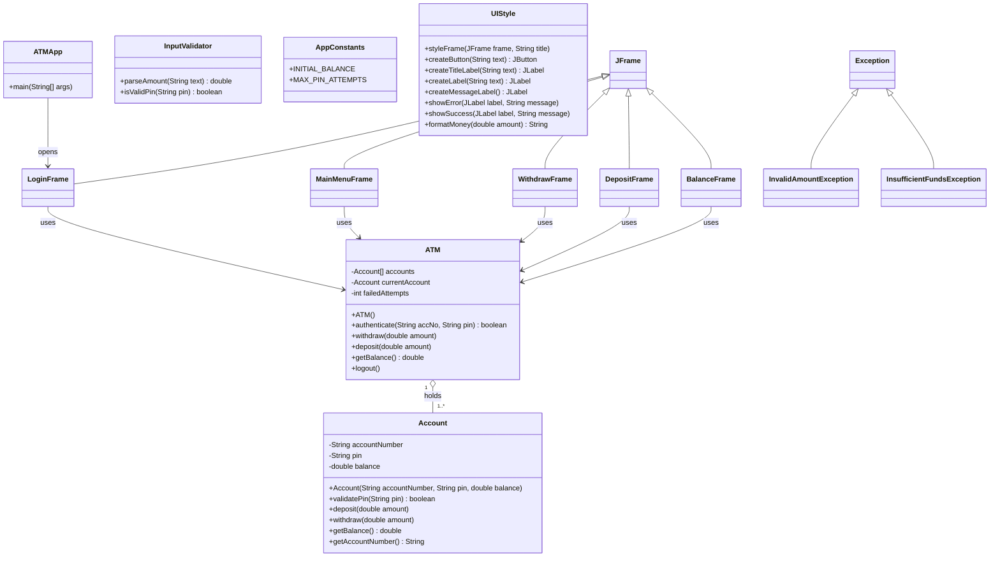

# ATM Application: Group 2

**Course:** Software Design 1 (SDN150S), Cape Peninsula University of Technology
**Project:** No. 2, Java ATM Application
**Due date:** 8 November 2026
**Examiner:** Mr S.O. Ekwe

This README is the team guide. Read it before writing any code. It explains what we are building, who owns which file, the names everyone must use, and how we work in Git.

---

## 1. What we are building

A Java desktop ATM with a Swing (`JFrame`) interface. The user logs in, then chooses from four options:

| Option | What it does |
|---|---|
| Withdraw | Asks for an amount, deducts it from the balance, shows a success message |
| Deposit | Asks for an amount, adds it to the balance, shows a success message |
| Check Balance | Shows the current balance |
| Exit | Closes the program with `System.exit(0)` |

The starting balance is **R10 000.00**.

### What we are marked on

| Part | Weight | Notes |
|---|---|---|
| Code implementation | 40% | Pseudocode (15), UML (15), code (50), demo video (15), scaled to 40% |
| Technical report | 40% | Max 2000 words, Cabri 11, 1.5 line spacing, Harvard referencing, PDF |
| Group participation | 20% | Tools: understand, use, create, evaluate their limits |

### Must-have Java concepts (marks are attached to each)

- **Constructors and modifiers:** every class has a constructor; fields are `private`, methods `public`
- **Control statements:** `if / else`, loops, `switch`, `try / catch`
- **JFrame forms:** hand-coded Swing screens
- **Comments and white space:** single-line and multi-line comments, neat spacing
- **Error handling and input validation**

### Submission checklist

- [ ] Source code (this repo)
- [ ] Technical report as PDF (includes the UML diagram and the pseudocode)
- [ ] Video demonstration, 3 to 5 minutes

---

## 2. How the program is built

The program has three layers. Each person owns separate files, so nobody edits the same file.

```
 Screens (JFrames)   ->   ATM (logic)   ->   Account (data)
 what the user sees       the rules          the balance and PIN
```

- **Account** holds the data: account number, PIN, balance.
- **ATM** is the controller. It checks logins and runs the transactions.
- **Frames** only draw the screen and call `ATM`. They contain no banking rules.
- **Helpers** (`InputValidator`, `AppConstants`, `UIStyle`, two exceptions) are shared by everyone.
- **UIStyle** gives every screen the same window size, font, colours and ready-made buttons and labels, so all five screens look like one app.

All screens receive the **same `ATM` object** through their constructor, so they all see the same balance.

### UML class diagram



### Screen flow

```
Login --(success)--> Main Menu --+--> Withdraw --+
                                 +--> Deposit  --+--> back to Main Menu
                                 +--> Balance  --+
                                 +--> Exit --> System.exit(0)
```

---

## 3. Who owns what

**Rule: you only edit your own files.** If you need a change in someone else's file, ask the owner.

| # | Name | GitHub | Role | Files you own | Your job |
|---|---|---|---|---|---|
| 1 | Aubrey Magolego | [`sinovuyo-asathi-danca`](https://github.com/sinovuyo-asathi-danca) | Data model | `Account.java`, `AppConstants.java` | Constructor, getters, `deposit`, `withdraw`, `validatePin`, constants |
| 2 | Mabandla Nkosi | [`mabandlascelaphile-lgtm`](https://github.com/mabandlascelaphile-lgtm) | Controller | `ATM.java` | Login check, 3-attempt lockout, wraps the Account operations |
| 3 | Vhukhudo Ravele | [`vhukhudo98`](https://github.com/vhukhudo98) | Validation | `InputValidator.java`, `InvalidAmountException.java`, `InsufficientFundsException.java` | Turn text into a valid amount, reject letters, zero and negatives |
| 4 | Muvhofhololi Tsanwani | [`muvhofhololitsanwani-design`](https://github.com/muvhofhololitsanwani-design) | Login screen | `LoginFrame.java` | Account number and PIN fields, error messages |
| 5 | Athenkosi Khau | [`Athenkosi28`](https://github.com/Athenkosi28) | Menu screen | `MainMenuFrame.java` | Four buttons; Exit calls `System.exit(0)` |
| 6 | Kgonyane Makgoale | [`kgonyaneChris`](https://github.com/kgonyaneChris) | Withdraw screen | `WithdrawFrame.java` | Amount field, success and error messages |
| 7 | Ndzalama Mthombeni | [`Precept-cyber`](https://github.com/Precept-cyber) | Deposit screen | `DepositFrame.java` | Amount field, success and error messages |
| 8 | Siyolise Mhlauli | [`mhlaulisiyolise5`](https://github.com/mhlaulisiyolise5) | Integration lead | `ATMApp.java`, `BalanceFrame.java`, `README.md` | `main()`, balance screen, merging pull requests, final testing, demo video |

**Backend and frontend:** members 1 to 3 write backend classes (no Swing). Members 4 to 8 each build their own screen: the Swing layout and the button logic together. There is no single "frontend person".

**Shared look:** `UIStyle.java` is owned by the team leader (Muvhofhololi), on top of their own screen (`LoginFrame`). Everyone else only *calls* it and never edits it. If you want a different colour or font, ask the leader.

**How roles were assigned:** member 4 is the team leader. Roles 1, 2, 3, 5, 6, 7 and 8 were drawn at random. If two people agree to swap, tell the leader and update this table in a pull request so the README always matches who owns what.

### Report sections (everyone writes one part)

| Report part | Owner |
|---|---|
| Introduction and sub-questions | 4 (Muvhofhololi) |
| Design approach and engineering method | 2 (Mabandla) |
| Pseudocode (section 7 below) | 3 (Vhukhudo) |
| UML diagram | 1 (Aubrey) |
| Tools and skills | 5 (Athenkosi) |
| Results and analysis (testing) | 6 (Kgonyane) and 7 (Ndzalama) |
| Conclusion and Harvard references | 8 (Siyolise) |

---

## 4. The shared contract (use these exact names)

Everyone codes against these signatures. Do not rename anything without telling the whole group, because other people's code depends on it.

```java
// Account.java
public Account(String accountNumber, String pin, double balance)
public boolean validatePin(String pin)
public void deposit(double amount)
public void withdraw(double amount) throws InsufficientFundsException
public double getBalance()
public String getAccountNumber()

// ATM.java
public ATM()                                     // creates the demo account with AppConstants.INITIAL_BALANCE
public boolean authenticate(String accNo, String pin)
public void withdraw(double amount) throws InsufficientFundsException
public void deposit(double amount)
public double getBalance()
public void logout()

// InputValidator.java
public static double parseAmount(String text) throws InvalidAmountException
public static boolean isValidPin(String pin)

// AppConstants.java
public static final double INITIAL_BALANCE = 10000.00;
public static final int MAX_PIN_ATTEMPTS = 3;

// UIStyle.java (all static, owned by the team leader)
public static void styleFrame(JFrame frame, String title)
public static JButton createButton(String text)
public static JLabel createTitleLabel(String text)
public static JLabel createLabel(String text)
public static JLabel createMessageLabel()
public static void showError(JLabel label, String message)
public static void showSuccess(JLabel label, String message)
public static String formatMoney(double amount)
```

Every screen is created with the shared ATM object:

```java
new WithdrawFrame(atm);
```

### Naming rules

- **Everything:** `camelCase` for variables and methods, `PascalCase` for classes
- **Swing components use these prefixes:**

| Component | Name |
|---|---|
| Buttons | `btnWithdraw`, `btnDeposit`, `btnBalance`, `btnExit`, `btnLogin`, `btnConfirm`, `btnBack` |
| Account number field | `txtAccNo` |
| PIN field (`JPasswordField`) | `pfPin` |
| Amount field | `txtAmount` |
| Labels | `lblBalance`, `lblMessage` |
| Panels | `pnlMain` |

### Other agreements

- **Package:** every file starts with `package atm;`
- **Money type:** `double` everywhere. Format it with `UIStyle.formatMoney(amount)`, which prints `R10 000.00`. Do not mix in `BigDecimal` or `int`.
- **Window look:** call `UIStyle.styleFrame(this, "Title")` first in your constructor. It sets the size (400 x 300), centres the window, sets the background and close behaviour. Create your buttons and labels with `UIStyle.createButton(...)` and the other `UIStyle` methods, so every screen looks the same.
- **Demo account:** account `1001`, PIN `1234`
- **Errors:** screens call `InputValidator.parseAmount(txt)` first, then `atm.withdraw(amount)`. They catch `InvalidAmountException` and `InsufficientFundsException` and show a `JOptionPane` message.

### Using UIStyle in your screen (example)

```java
public class WithdrawFrame extends JFrame {

    // Fields are private (modifiers marks)
    private ATM atm;
    private JTextField txtAmount;
    private JButton btnConfirm;
    private JLabel lblMessage;

    public WithdrawFrame(ATM atm) {
        this.atm = atm;

        UIStyle.styleFrame(this, "Withdraw");   // size, centre, background, close
        setLayout(new GridLayout(4, 1, 10, 10));

        add(UIStyle.createTitleLabel("Withdraw"));

        txtAmount = new JTextField();
        add(txtAmount);

        btnConfirm = UIStyle.createButton("Confirm");
        add(btnConfirm);

        lblMessage = UIStyle.createMessageLabel();
        add(lblMessage);

        // Later, inside your button logic:
        // UIStyle.showError(lblMessage, "Insufficient funds");
        // UIStyle.showSuccess(lblMessage, "New balance: " + UIStyle.formatMoney(atm.getBalance()));

        setVisible(true);
    }
}
```

### File header (put this at the top of your file for the author marks)

```java
/*
 * File:        WithdrawFrame.java
 * Author:      Your Name (Student No.)
 * Group:       Group 2, SDN150S
 * Description: Screen that lets the user withdraw money.
 */
```

Comment your fields and each section of the layout code. White space and comments carry marks.

---

## 5. Setting up and working in Git

### One-time setup (VS Code)

1. Install **JDK 17 or newer** (everyone on the same version).
2. Install the **Extension Pack for Java** from Microsoft.
3. Clone the repo and **open the repo folder** in VS Code.
4. Folder layout:

```
atm-project-group2/
├── src/
│   └── atm/
│       ├── ATMApp.java
│       ├── ATM.java
│       ├── Account.java
│       ├── UIStyle.java
│       └── ... (one file per class)
├── README.md
└── .gitignore            <- must ignore bin/, out/ and *.class
```

There is no drag-and-drop designer in VS Code. Everyone hand-codes their screen by extending `JFrame`.

### Every working session

1. `git pull origin main`
2. Switch to your branch: `git checkout -b feature/<your-file>` the first time, e.g. `feature/withdraw-frame`
3. Edit **only your own files**
4. Commit small and often, with clear messages such as `Add input validation to WithdrawFrame`
5. `git push origin feature/<your-file>`
6. Open a **pull request** into `main`. Member 8 reviews and merges.

The brief marks the commit history, so regular, meaningful commits matter.

### Testing your file on its own

Until `ATMApp` exists, add a temporary `main()` in your own file to run it. **Delete it before you merge.**
Backend members can test with a small `main()` that calls their methods (for example, withdraw more than the balance and check the exception). Keep the output for the report's results section.

---

## 6. Suggested timeline

| By | Milestone |
|---|---|
| 25 Oct | Members 1 and 2 push compiling stubs of `Account` and `ATM`, and the team leader pushes `UIStyle`, so everyone can compile |
| 1 Nov | Every screen works on its own against the stubs; backend classes finished |
| 4 Nov | All pull requests merged; full run-through; bugs fixed |
| 6 Nov | Report finished and checked against the rubric; demo video recorded |
| 8 Nov | Submit: code, PDF report, video |

---

## 7. Pseudocode

### Program start (`ATMApp`)

```
START the program
    Create one ATM object, which sets up the demo account
    Create and show the Login screen, giving it the ATM object
END
```

### Account

```
WHEN a new Account is created
    Receive an account number, a PIN and a starting balance
    Store all three privately

TO check a PIN
    IF the PIN given matches the stored PIN
        Report TRUE
    ELSE
        Report FALSE

TO deposit an amount
    Add the amount to the balance

TO withdraw an amount
    IF the amount is more than the balance
        Raise an "insufficient funds" error
    ELSE
        Subtract the amount from the balance

TO get the balance
    Report the stored balance
```

### ATM (controller)

```
WHEN the ATM is created
    Create the demo account with the starting balance of R10 000.00
    Set failed attempts to zero
    Set the current account to nothing

TO authenticate a user (account number and PIN given)
    Search the account list for the account number
    IF no account is found
        Add one to failed attempts
        Report FALSE
    ELSE IF the PIN does not match
        Add one to failed attempts
        Report FALSE
    ELSE
        Set the current account to the account found
        Reset failed attempts to zero
        Report TRUE

TO withdraw an amount
    Ask the current account to withdraw the amount
    (any insufficient funds error passes back to the screen)

TO deposit an amount
    Ask the current account to deposit the amount

TO get the balance
    Ask the current account for its balance and report it

TO log out
    Set the current account to nothing
```

### InputValidator

```
TO convert text to an amount
    IF the text is empty
        Raise an "invalid amount" error
    TRY to read the text as a number
        IF that fails because it contains letters or symbols
            Raise an "invalid amount" error
    IF the number is zero or negative
        Raise an "invalid amount" error
    Report the number

TO check a PIN
    IF the PIN is exactly four digits
        Report TRUE
    ELSE
        Report FALSE
```

### Login screen

```
WHEN the Login screen is created
    Receive the ATM object and keep it
    Draw the account number field, the PIN field and the Login button

WHEN the user presses Login
    Read the account number and PIN from the fields
    IF either field is empty or the PIN is not four digits
        Show a message asking for valid details
    ELSE
        Ask the ATM to authenticate the details
        IF authentication succeeded
            Close the Login screen
            Open the Main Menu screen
        ELSE
            IF failed attempts has reached the maximum of 3
                Show a "card blocked" message
                Exit the program
            ELSE
                Show an "incorrect details" message with attempts remaining
                Clear the PIN field
```

### Main Menu screen

```
WHEN the Main Menu is created
    Receive the ATM object and keep it
    Draw four buttons: Withdraw, Deposit, Check Balance, Exit

WHEN the user presses a button
    IF Withdraw was pressed
        Open the Withdraw screen
    ELSE IF Deposit was pressed
        Open the Deposit screen
    ELSE IF Check Balance was pressed
        Open the Balance screen
    ELSE IF Exit was pressed
        Ask the ATM to log out
        Close the whole program
```

### Withdraw screen

```
WHEN the Withdraw screen is created
    Receive the ATM object and keep it
    Draw the amount field, a Confirm button and a Back button

WHEN the user presses Confirm
    TRY
        Convert the text in the amount field to a number
        Ask the ATM to withdraw that amount
        Show a "withdrawal successful" message with the new balance
        Clear the amount field
    IF the amount was invalid
        Show an "enter a valid positive amount" message
    IF there were insufficient funds
        Show an "insufficient funds" message with the available balance

WHEN the user presses Back
    Close this screen and show the Main Menu
```

### Deposit screen

```
WHEN the Deposit screen is created
    Receive the ATM object and keep it
    Draw the amount field, a Confirm button and a Back button

WHEN the user presses Confirm
    TRY
        Convert the text in the amount field to a number
        Ask the ATM to deposit that amount
        Show a "deposit successful" message with the new balance
        Clear the amount field
    IF the amount was invalid
        Show an "enter a valid positive amount" message

WHEN the user presses Back
    Close this screen and show the Main Menu
```

### Balance screen

```
WHEN the Balance screen is created
    Receive the ATM object and keep it
    Draw a label and a Back button
    Ask the ATM for the balance
    Show the balance on the label, formatted as rand with two decimals

WHEN the user presses Back
    Close this screen and show the Main Menu
```

---

## 8. Open decisions (confirm as a group)

- [ ] **Exit behaviour:** the brief says Exit returns to the home screen but also says to use `System.exit(0)`, which closes the whole program. We assume Exit closes the app. Ask Mr Ekwe if unsure.
- [ ] **Lockout:** three wrong PINs close the program (our assumption; the brief does not mention it)
- [ ] **PIN length:** four digits (our assumption)
- [ ] **Back buttons:** added on Withdraw, Deposit and Balance so the menu is not a dead end

## 9. Definition of done (before you open a pull request)

- [ ] Your file compiles and runs
- [ ] You used the shared names from section 4
- [ ] Your screen uses `UIStyle` for window setup, buttons, labels and money format
- [ ] Constructor, `private` fields and `public` methods are used correctly
- [ ] Input is validated and errors show a clear message
- [ ] Header comment with your name, plus comments and white space throughout
- [ ] Temporary test `main()` removed
- [ ] Committed with a meaningful message
